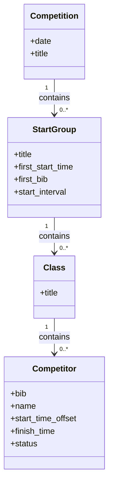

# Tupal

Tupal is a competition management and results system. The name "Tupal" comes from the Finish word "tulospalvelu", meaning literally "result service".

The key concepts of Tupal are of course self-evident _competition_, _competitor_ and _class_, added with a _start group_. A _start group_ contain collection of _classes_ that share the same bib range, the same first start time, and the starting interval.



Tupal consists of centralized backend service "tupald" and the following web-apps for different purposes:
* Competition Management App - This is fundamentally for establishing competition: competition, start groups, and classes; and for event time management: publishing results, making required corrections etc. This work is mainly done in an office-like conditions, near the competition venua, with a laptop and mice.
* Competitor Registration App - Adding new competitors at the competition venua. This is typically done on the field, perhaps under a canopy, with a ligth laptop or tablet with keyboard.
* Start App - For officials at start line. This can be used to to supervise starting and mark missing competitors as DNS (did not start). Used at the field, with e.g. smartphone.
* Times App - For timekeeper, to take times. This is used at the field, e.g. with smartphone.
* Numbers App - For typing bib numbers as they reach the finish line. Used at the field, with e.g. smartphone.
* Finishline App - Combines Times & Numbers for small events, or can be used in larger events by a supervising finish official for helping in rush situations, or to make immediate corrections to times and numbers.

For a very small events, rehersal competions or trainings the system can be used with one laptop (runnign Competition Management App, and the tupald) and one mobile device, tablet or smartphone running the Finishline App.

From a technical viewpoint Tupal backend is a C++ daemon with a REST API, while the apps are web apps, written with TypeScript and Svelte. The database is defaulted to SQLite, but utilizes the SOCI that enables switching to centralized DBMS such as PostgreSQL.

## Quick start

### Build & test

Requirements: CMake, a C++17 compiler, Boost, and Node.js/npm for the web
frontend. The expected Node.js version is recorded in `web/.nvmrc`.

```sh
cmake -S . -B build
cmake --build build --parallel
(cd web; npx playwright install --with-deps chromium)
ctest --test-dir build --output-on-failure
```

### Run Tupal with sample data

Start tupald with defaults on port 8085 with in-memory database:

```sh
build/src/tupald &
```

Populate system with test data:

```sh
./script/make-test-data.sh
```

The different apps can be opened with your favourite web browser by opening the following url's:

| Application | Default URL |
| Competition Management App | <http://localhost:8085/management/> |
| Registration App | <http://localhost:8085/registration/comp-1> |
| Start App | <http://localhost:8085/start/comp-1> |
| Times App | <http://localhost:8085/times/comp-1> |
| Numbers App | <http://localhost:8085/numbers/comp-1> |
| Finishline App | <http://localhost:8085/finishline/comp-1> |

Additionally, on linux environment a command line tool tupal-cli is provided. For example,
a competition can be created by:

```sh
script/tupal-cli create competition --id my-comp --title "My competition" --date 2026-11-12
```

Backend process tupald and command line client tupal-cli, both support --help -option, e.g.

```sh
script/tupal-cli --help
build/src/tupald --help
```

## Build reference

Configure the project with:

```sh
cmake -S . -B build [options]
```

Useful CMake options:

| Option | Default | Description |
|---|---:|---|
| `BUILD_PROJECT_TESTS` | `ON` | Build and register Tupal's tests. |
| `BUILD_DEPENDENCY_TESTS` | `OFF` | Allow dependencies to build their own tests. |

Build the default target or a specific target:

```sh
cmake --build build --parallel
cmake --build build --target tupald
```

Project targets:

| Target | Description |
|---|---|
| `all` | Default build: Tupal libraries, daemon, tests (when enabled), and frontend assets. |
| `tupald` | Tupal HTTP/WebSocket daemon. |
| `tupal_core` | Core competition and data-management library. |
| `web_frontend` | Checks and builds the web frontend into `build/src/web`. Included in the default build. |
| `web_docs` | Generates the web TypeScript/JavaScript reference with Doxygen, when Doxygen is available at CMake configure time. |
| `manager_tests`, `model_tests`, `rest_tests` | Native C++ test executables. |

To see all targets, including dependency targets, run:

```sh
cmake --build build --target help
```

## Test reference

CTest tests and labels:

| Test | Labels | Description |
|---|---|---|
| `manager_tests` | `tupal`, `manager` | Competition, start-group, class, and competitor manager tests. |
| `model_tests` | `tupal`, `model` | Data model and serialization tests. |
| `rest_tests` | `tupal`, `rest` | REST, WebSocket, and generic static-file server tests. |
| `web_system_smoke` | `tupal`, `web`, `system` | Starts the daemon, seeds via REST, and exercises registration UI in Chromium. |

Run all tests, a test by name, or tests matching a label:

```sh
ctest --test-dir build --output-on-failure
ctest --test-dir build -R manager_tests --output-on-failure
ctest --test-dir build -L rest --output-on-failure
ctest --test-dir build -L system --output-on-failure
```

CTest labels are regular expressions. The `tupal` label selects all four
Tupal test groups, including the browser smoke test. List discovered tests with:

```sh
ctest --test-dir build -N
ctest --test-dir build -N -V
```

## Web API documentation

The TypeScript and JavaScript modules under `web/src` are documented with
Doxygen:

```sh
cd web
doxygen Doxyfile
```

Open `web/docs/html/index.html`. Alternatively, if Doxygen was found during
CMake configuration, run `cmake --build build --target web_docs`.
